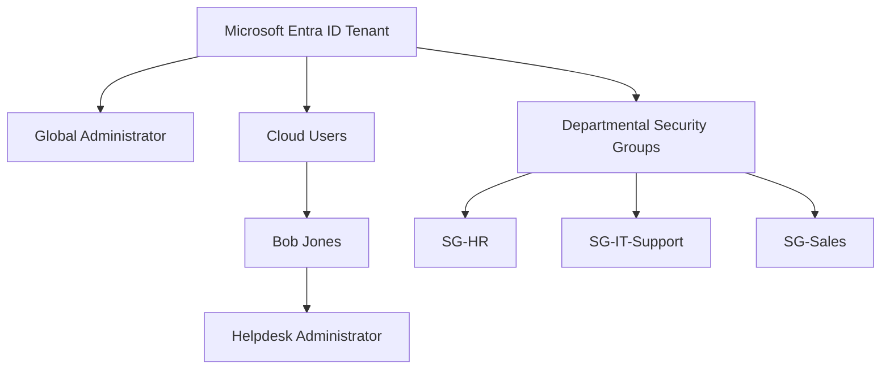

# Microsoft Entra ID | Cloud Identity & Access Management Lab

**Project status: In progress**

## Overview

This hands-on lab simulates identity administration for a fictional enterprise, Contoso Labs, using Microsoft Entra ID. The project focuses on employee provisioning, departmental security groups, delegated administration, least privilege, and planned identity automation.

## Technologies

- Microsoft Entra ID (Free)
- Microsoft Azure portal
- Microsoft Graph PowerShell (planned)

## Lab Architecture

## 1. Tenant Configuration

Configured a dedicated Microsoft Entra ID tenant for a simulated enterprise environment using the free licensing tier.

## 2. Employee Provisioning

Created three cloud user accounts with organizational attributes, including job titles, departments and employee IDs.

| Employee | Job title | Department |
|---|---|---|
| Alice Smith | HR Specialist | Human Resources |
| Bob Jones | IT Support Technician | IT Support |
| Carol Davis | Sales Representative | Sales |

All employee identities are fictional lab accounts.

## 3. Security Groups

Created assigned-membership security groups to model departmental access.

| Security group | Intended membership |
|---|---|
| SG-HR | Alice Smith |
| SG-IT-Support | Bob Jones |
| SG-Sales | Carol Davis |

Departmental membership is the foundation for future access assignments; group creation alone does not grant access to applications or resources.

## 4. Role-Based Access Control (RBAC)

Assigned the built-in Helpdesk Administrator directory role to Bob Jones to model delegated IT support responsibilities without granting Global Administrator privileges.

## 5. Security Validation

Planned tests:

- Verify delegated password reset for a non-administrative user.
- Verify restrictions on privileged role assignment.
- Review MFA configuration and available audit logs.

## 6. PowerShell Automation

Planned Microsoft Graph PowerShell workflows:

- Retrieve cloud user accounts.
- Enumerate security groups and memberships.
- Automate employee provisioning.
- Export an identity inventory to CSV.

## 7. Project Evidence

Screenshots and validated scripts will be added as implementation progresses. Credentials and personal account information will not be published.

## Implementation Progress

- [x] Configure Entra ID tenant
- [x] Provision cloud employee accounts
- [x] Create departmental security groups
- [x] Assign delegated Helpdesk Administrator role
- [ ] Complete permission validation
- [ ] Review MFA and audit logs
- [ ] Implement and test PowerShell automation
- [ ] Publish sanitized evidence

## Related Project

[Active Directory Home Lab](https://github.com/DJMarsail/Active-directory-home-lab) — Windows Server, Active Directory Domain Services, Group Policy, DNS and file-share access control.

The two labs currently operate independently. Hybrid identity synchronization is a potential future extension, not an implemented feature.
