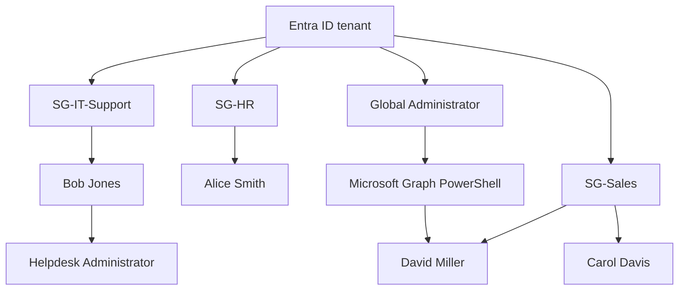

# Microsoft Entra ID | Cloud Identity & Access Management Lab

## Overview

A hands-on cloud identity administration lab for a fictional enterprise, Contoso Labs, using Microsoft Entra ID Free and Microsoft Graph PowerShell.

## Architecture

## Identity provisioning and security groups

| Employee | Department | Job title | Employee ID | Security group |
|---|---|---|---|---|
| Alice Smith | Human Resources | HR Specialist | 1001 | SG-HR |
| Bob Jones | IT Support | IT Support Technician | 1002 | SG-IT-Support |
| Carol Davis | Sales | Sales Representative | 1003 | SG-Sales |
| David Miller | Sales | Sales Associate | 1004 | SG-Sales |

The first three fictional employee accounts were provisioned manually. David was provisioned through Microsoft Graph PowerShell and automatically added to SG-Sales. All four employee accounts were verified as enabled. Groups use assigned membership; no application or resource access assignments were tested.

## Security validation

| Test | Observed result |
|---|---|
| Delegated administration | Bob received a direct assignment to the built-in Helpdesk Administrator role |
| Password reset | Bob successfully reset Alice's password |
| Least privilege | Add assignments was disabled when signed in as Bob |
| MFA | Microsoft Authenticator enrolled and used by Bob |
| Audit logging | Successful password reset recorded in Alice's audit logs with Bob as actor |
| Group membership audit | All four employees returned in their expected groups |
| Automated onboarding | David's account and Sales membership independently verified |
| CSV inventory | User attributes and enabled status successfully exported |

The least-privilege test was performed in the Entra portal; it was not a comprehensive API authorization assessment.

## PowerShell automation

The scripts use the Microsoft Graph PowerShell SDK and interactive delegated authentication.

| Script | Purpose |
|---|---|
| [New-Employee.ps1](scripts/New-Employee.ps1) | Provision an employee, require password change at first sign-in, assign departmental group |
| [Get-GroupMembership.ps1](scripts/Get-GroupMembership.ps1) | Enumerate direct security group memberships |
| [Export-UserInventory.ps1](scripts/Export-UserInventory.ps1) | Export user inventory to CSV |

The scripts package the lab commands into reusable, parameterized utilities. Validation was performed using interactive PowerShell commands rather than standalone script execution. No passwords or tenant identifiers are hardcoded.

## Evidence

[Screen captures](screenshots/) document provisioning, group membership, directory configuration, delegated roles, MFA, audit logs and portal permission restrictions.

## Scope and related project

This lab uses Entra ID Free. Intune, Conditional Access, Microsoft 365 administration and hybrid synchronization were not implemented.

[Active Directory Home Lab](https://github.com/DJMarsail/Active-directory-home-lab) demonstrates Windows Server, AD DS, Group Policy, DNS and file-share access control. The two environments operate independently.
